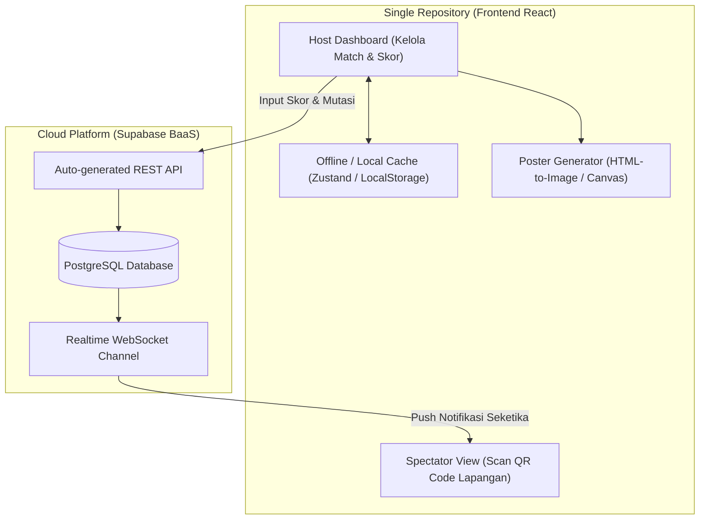

# 🎾 Tennis Junkies – System Architecture & Project Blueprint

Dokumen rancangan (*blueprint*) untuk pembuatan ulang aplikasi **The Junkies Co. – Matchmaking & Live Leaderboard System** menjadi aplikasi web modern berarsitektur **Single Repository** dengan **Vite + React (TypeScript)** dan **Cloud Database (Supabase)**.

---

## 1. Ikhtisar & Tujuan Proyek

* **Nama Proyek:** `tennis-junkies`
* **Target Pengguna:**
  * **Host / Penanggung Jawab Lapangan:** Mengatur sesi, rotasi lapangan, live swap pemain, catat skor, koreksi match, dan ekspor poster klasemen.
  * **Pemain & Penonton (Spectator):** Mengakses jadwal lapangan dan klasemen *live* melalui scan QR Code dari smartphone masing-masing secara *real-time*.
* **Tujuan Utama:**
  * Menghilangkan jeda/latensi lambat (2–5 detik) dari sistem Google Apps Script lama.
  * Tahan koneksi buruk di lapangan (*offline-first capability*).
  * Antarmuka modern, bersih, dan ramah sentuhan satu tangan (*thumb-friendly mobile first*).
  * Pembaruan data otomatis (*realtime websocket*) antar-perangkat.

---

## 2. Arsitektur Sistem (Single Repository)

Aplikasi dibangun menggunakan pola **Backend-as-a-Service (BaaS)**, sehingga seluruh kode antarmuka dan interaksi data berada dalam **satu repository** tanpa perlu membuat server backend terpisah.



---

## 3. Tech Stack

| Layer | Teknologi | Alasan Pemilihan |
| :--- | :--- | :--- |
| **Framework** | **React 19 / 18 + Vite** | Ringan, kompilasi kilat, ekosistem library kaya untuk *vibe coding*. |
| **Language** | **TypeScript** | Memastikan tipe data (pemain, match, skor) aman dan minim bug. |
| **Styling** | **Tailwind CSS v3 / v4** | Memudahkan styling responsif mobile dengan palet warna khas *The Junkies Co.* (`#FF6B00` & `#1A1A1A`). |
| **Icons** | **Lucide React** | Ikon clean, modern, dan ringan. |
| **Cloud Database** | **Supabase (PostgreSQL)** | Menyimpan sesi, match, dan leaderboard dengan fitur *Realtime Sync* gratis. |
| **State Management** | **Zustand + LocalStorage** | Sinkronisasi state lokal instan, aman jika browser ter-refresh di lapangan. |
| **Poster Export** | **html-to-image / Canvas API** | Menghasilkan poster story resolusi tinggi (720×1280px) siap dibagikan ke WhatsApp / IG. |
| **Deployment** | **Vercel / Cloudflare Pages** | Hosting frontend gratis, otomatis deploy dari Git. |

---

## 4. Fitur Utama & Modul Aplikasi

### 4.1. Modul 1: Setup Mabar Session (Host Mode)
* **Pilihan Event / ID Mabar:**
  * *Tennis Junkies Beginner Game*
  * *Tennis Junkies Upper Beginner Game*
  * *Tennis Junkies Intermediate Game*
  * *Tennis Junkies Single Game*
* **Pemilihan Host:** Admin, Alfonso, Yessy, Jazzy, Fitha, Ezra (atau custom host).
* **Konfigurasi Lapangan:** Single / Double, kapasitas 1 hingga 4 Court.
* **Input Peserta Cerdas:**
  * Multi-line input dengan counter kuota realtime.
  * Validasi limit: Single (maks 6 pemain), Double (`Court × 8` pemain).
* **Sistem Substitusi:** Ganti nama pemain yang cedera/keluar dengan pemain baru tanpa merusak riwayat pertandingan yang sudah selesai.

### 4.2. Modul 2: Matchmaking & Rotasi Otomatis
* Algoritma rotasi pemain berimbang:
  * Memastikan setiap pemain mendapatkan giliran main yang setara.
  * Mengurangi kemungkinan bertemu pasangan / lawan yang sama berturut-turut.
* Generate otomatis babak berikutnya (`generateNextRound`) saat seluruh court pada ronde aktif telah disubmit.

### 4.3. Modul 3: Active Matches & Live Swap
* Tampilan kartu pertandingan per Court dengan penanda ronde (`ROUND 1`, `ROUND 2`, dst.).
* **Live Swap Dropdown:** Host dapat menukar posisi pasangan/lawan secara instan di lapangan sebelum skor dimasukkan.
* Tombol input skor berukuran besar yang nyaman ditekan di smartphone.

### 4.4. Modul 4: Riwayat & Koreksi Match (Edit Log)
* Log seluruh pertandingan yang sudah tuntas.
* Fitur *inline editing* jika host salah memasukkan angka skor atau susunan pemain, dengan rekalkulasi klasemen instan.

### 4.5. Modul 5: Live Standings (Klasemen Real-time)
* Tabel klasemen otomatis:
  * Posisi (Rank) dengan medali/warna khusus Top 3 (Oranye, Amber, Hijau).
  * Kolom: **Played (P)**, **Won (W)**, **Lost (L)**, **Points (Pts)**.
* Tersinkronisasi secara langsung ke seluruh HP penonton/pemain melalui Supabase Realtime.

### 4.6. Modul 6: Spectator View (Mode Publik / QR Code)
* Halaman khusus untuk pemain (`/live/:sessionId`).
* Tampilan bersih, read-only:
  * Di court mana dan ronde ke berapa pemain tersebut dijadwalkan bermain.
  * Klasemen sementara secara live.
  * Tanpa tombol edit/reset (aman dari kesalahan pencet peserta).

### 4.7. Modul 7: Poster Klasemen Akhir (Story Generator)
* Ekspor klasemen ke format gambar PNG (resolusi 720×1280 px).
* Desain elegan bertema gelap-oranye khas *The Junkies Co.*, lengkap dengan nama event, tanggal format Indonesia, dan daftar Top 15 peserta.

---

## 5. Perancangan Skema Database (Supabase / PostgreSQL)

Berikut adalah struktur tabel yang disiapkan untuk Supabase:

```sql
-- 1. TABEL SESI MABAR
create table sessions (
  id uuid primary key default gen_random_uuid(),
  event_title text not null,
  host_name text not null,
  game_type text check (game_type in ('Single', 'Double')) default 'Double',
  court_count int not null default 1,
  current_round int not null default 1,
  status text check (status in ('draft', 'active', 'completed')) default 'draft',
  created_at timestamp with time zone default now()
);

-- 2. TABEL PEMAIN DALAM SESI
create table session_players (
  id uuid primary key default gen_random_uuid(),
  session_id uuid references sessions(id) on delete cascade,
  player_name text not null,
  is_active boolean default true,
  created_at timestamp with time zone default now()
);

-- 3. TABEL PERTANDINGAN (MATCHES)
create table matches (
  id uuid primary key default gen_random_uuid(),
  session_id uuid references sessions(id) on delete cascade,
  round int not null,
  court int not null,
  team_a1 text not null,
  team_a2 text default '',
  team_b1 text not null,
  team_b2 text default '',
  score_a int default null,
  score_b int default null,
  status text check (status in ('pending', 'completed')) default 'pending',
  created_at timestamp with time zone default now(),
  updated_at timestamp with time zone default now()
);

-- Realtime publication untuk live update
alter publication supabase_realtime add table sessions;
alter publication supabase_realtime add table matches;
alter publication supabase_realtime add table session_players;
```

---

## 6. Rencana Struktur Folder (Directory Structure)

```
tennis-junkies/
├── init.md                  # Dokumen blueprint ini
├── index.html               # Entry point HTML
├── package.json             # Dependensi project
├── vite.config.ts           # Konfigurasi Vite
├── tailwind.config.js       # Konfigurasi Tailwind & warna custom
├── src/
│   ├── main.tsx             # Entry point React
│   ├── App.tsx              # Routing & Controller Utama
│   ├── index.css            # Style global & Tailwind
│   ├── types/
│   │   └── tennis.ts        # Interface TypeScript (Session, Match, Player, Standing)
│   ├── lib/
│   │   ├── supabase.ts      # Client Supabase & Realtime subscription
│   │   └── rotation.ts      # Algoritma rotasi matchmaking tennis
│   ├── components/
│   │   ├── Header.tsx       # Brand header The Junkies Co. & Session ID badge
│   │   ├── SessionSetup.tsx # Form setup mabar, kuota counter, substitusi nama
│   │   ├── ActiveMatches.tsx# Kartu match per court, live swap, submit score
│   │   ├── MatchHistory.tsx # Log riwayat pertandingan & mode edit lengkap
│   │   ├── Standings.tsx    # Tabel klasemen live
│   │   ├── ShareModal.tsx   # Poster preview & tombol download 720x1280px
│   │   └── QrModal.tsx      # Tampilan QR Code untuk discan pemain di lapangan
│   └── hooks/
│       └── useTennisSession.ts # Custom hook logic mabar (hybrid local + supabase)
```

---

## 7. Tahapan Eksekusi (Roadmap)

1. **Fase 1: Inisialisasi Project Frontend**
   * Setup Vite + React (TypeScript) + Tailwind CSS + Lucide Icons.
   * Konfigurasi tema warna *The Junkies Co.* (Dark `#1A1A1A` & Orange `#FF6B00`).
2. **Fase 2: Core Tennis Logic & Local State**
   * Buat algoritma rotasi lapangan (*fair rotation matchmaking*).
   * Implementasi form setup sesi, kuota counter, kartu court active match, live swap, dan klasemen.
   * Pastikan aplikasi bisa langsung dimainkan 100% lancar di mode lokal/offline lebih dulu.
3. **Fase 3: Cloud Database & Realtime Sync (Supabase)**
   * Hubungkan client `@supabase/supabase-js`.
   * Implementasi sinkronisasi data cloud & listener realtime untuk mode *Spectator* (QR Code).
4. **Fase 4: Poster Story Generator**
   * Implementasi export canvas kartu klasemen ukuran story (720×1280 px).
5. **Fase 5: Polishing & Deploy**
   * Uji coba responsivitas mobile di berbagai ukuran layar smartphone.
   * Deploy ke Vercel/Netlify.

